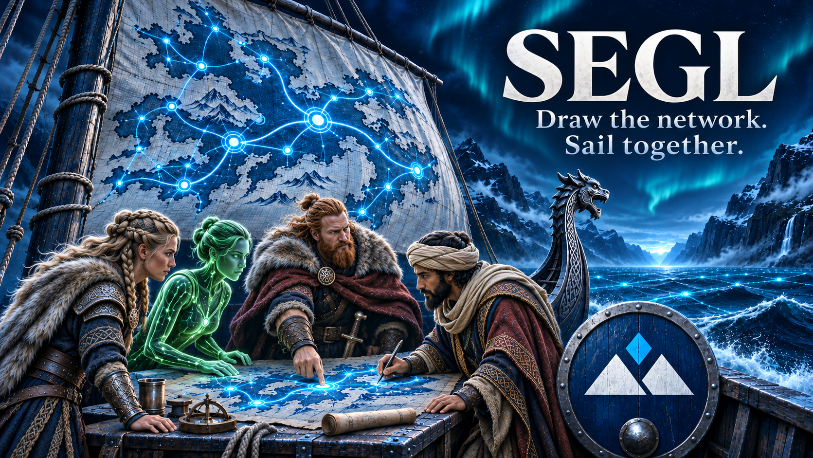

# segl draft2 — agent workbook

**Status:** Workbook for the next implementation task. The product manual is [`docs/`](../docs/README.md).
**Date:** 2026-11-11
**License:** Apache License 2.0 (`LICENSE` at the repository root). Excalidraw remains under its own license.

`draft1/` is frozen history. This folder holds the live task queue. Product behavior is specified in `docs/`.

## What to read

1. [`STATUS.md`](STATUS.md) — the only next action, and the completed log.
2. [`AGENTS.md`](AGENTS.md) — how to work one task and how to update status.
3. The single task named in STATUS, inside [`TASKS.md`](TASKS.md).
4. [`docs/ARCHITECTURE.md`](../docs/ARCHITECTURE.md) when the task needs to know how the parts run together.
5. The contract pages a task cites under [`docs/`](../docs/README.md).
6. [`docs/DECISIONS.md`](../docs/DECISIONS.md) before changing a locked choice. [`docs/ROADMAP.md`](../docs/ROADMAP.md) lists work that is intentionally later.

## System in one pass

A browser opens `s/N` under segl's root (`N` is 1–9), such as `https://dev.example.com/board/s/1`, where nginx strips `/board`. Python returns the React application with asset URLs relative to the page, and a small runtime config that names the way back to segl's root. The page loads that slot's scene from SQLite, assigns a display label if the browser does not already have one, and joins a WebSocket room for that slot. Element edits and cursors fan out to the other browsers on the same slot. The server writes the head scene to SQLite and keeps the latest 50 revisions for restore. Slot 9 is the same mechanism as slot 1. A future protected area under `/{team}/{project}/{board}` is reserved and is not part of this MVP.

## Repository the tasks create

```text
segl/
  AGENTS.md                 # pointer at draft2
  README.md                 # public project page
  LICENSE
  NOTICE                    # attributions (D2-019)
  CONTRIBUTING.md
  SECURITY.md               # how to report a vulnerability
  CHANGELOG.md
  versions.toml             # the only version list
  journal/                   # narrative highlights
  scripts/release.py
  scripts/build_docs.py     # documentation site (T00b)
  tools/md2html/            # Markdown to HTML, copied from vakr
  images/                   # pictures for any page
  docs/                     # contributor and operator manual
  draft1/                   # frozen historical baseline, kept in git
  draft2/                   # agent workbook: status, tasks, rules
  pyproject.toml            # mirrors versions.toml
  uv.lock
  .python-version           # mirrors versions.toml runtime.python
  src/segl/                 # FastAPI application
  tests/                    # pytest
  web/                      # Vite + React + TypeScript + Excalidraw, npm (D2-023)
  deploy/
    display-names.txt
    segl.toml.example
    nginx/                  # files a site includes; /board/ example (T00)
    systemd/segl.service
    Containerfile
    debian/
```

Production layout, built by T12, is separate from the git checkout:

```text
/opt/segl/python/           # uv-pinned CPython
/opt/segl/venv/             # application virtualenv
/opt/segl/app/              # server code and built web assets
/opt/segl/share/nginx/      # the deploy/nginx files
/opt/segl/etc/segl.toml
/opt/segl/etc/display-names.txt
/opt/segl/var/segl.sqlite
/opt/segl/var/assets/
```
